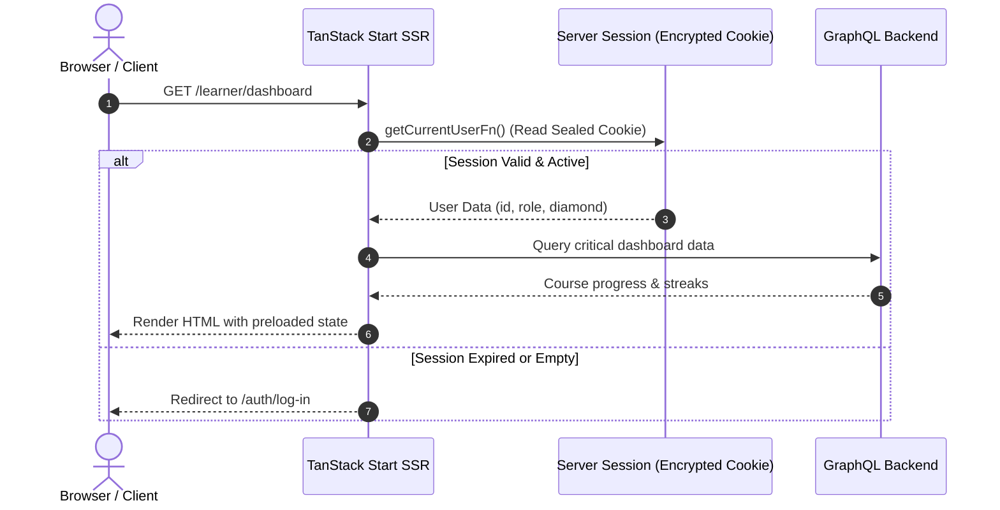
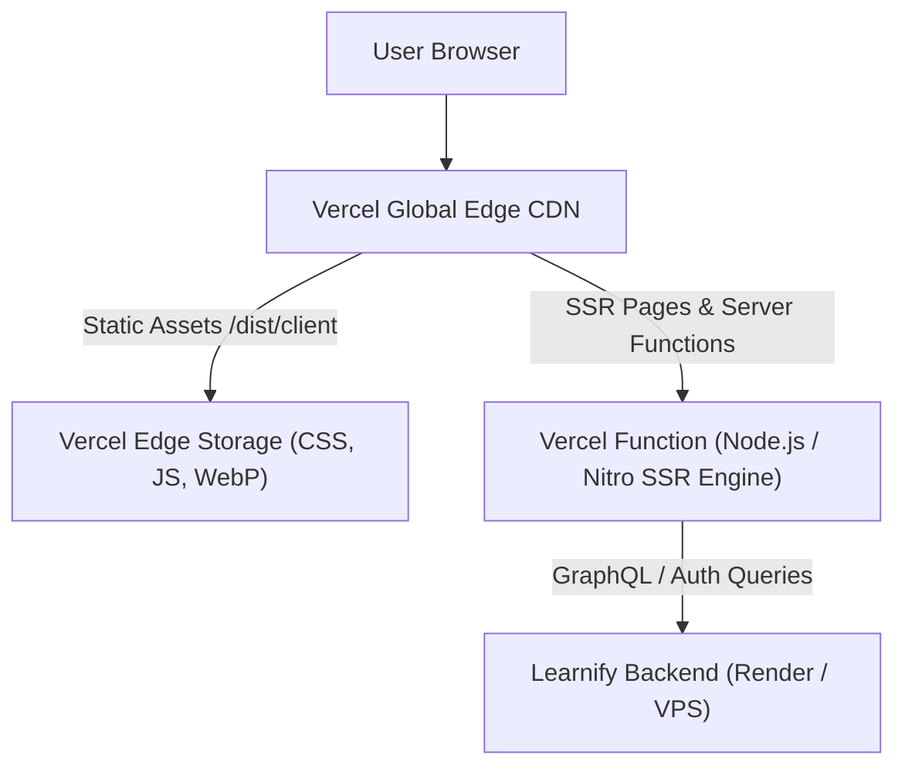

# Learnify Frontend — Project Architecture, Tech Stack & Vercel Deployment Guide

> **Project Name:** `learnify-fe-tanstack`  
> **Application Type:** AI-Powered Learning Management System (LMS)  
> **Target Audience:** Developers, DevOps Engineers, AI Assistants, and System Architects

---

## Table of Contents

1. [Executive Summary & Project Context](#1-executive-summary--project-context)
2. [Technology Stack](#2-technology-stack)
3. [Project Directory & File Structure](#3-project-directory--file-structure)
4. [Routing & Role-Based Access Architecture](#4-routing--role-based-access-architecture)
5. [State Management & Data Layer](#5-state-management--data-layer)
6. [Styling & Design System](#6-styling--design-system)
7. [Step-by-Step Vercel Deployment Guide](#7-step-by-step-vercel-deployment-guide)
   - [7.1 Architecture on Vercel (TanStack Start & Nitro)](#71-architecture-on-vercel-tanstack-start--nitro)
   - [7.2 Prerequisites](#72-prerequisites)
   - [7.3 Environment Variables Configuration](#73-environment-variables-configuration)
   - [7.4 Deployment Method A: Vercel Web Dashboard (Git Integration)](#74-deployment-method-a-vercel-web-dashboard-git-integration)
   - [7.5 Deployment Method B: Vercel CLI](#75-deployment-method-b-vercel-cli)
   - [7.6 Cross-Origin Cookie, CORS & CSRF Solutions](#76-cross-origin-cookie-cors--csrf-solutions)
   - [7.7 Google OAuth Configuration for Vercel](#77-google-oauth-configuration-for-vercel)
   - [7.8 Post-Deployment Troubleshooting & Common Issues](#78-post-deployment-troubleshooting--common-issues)

---

## 1. Executive Summary & Project Context

**Learnify** is an educational platform and AI-powered Learning Management System (LMS) built with React 19 and TanStack Start.

### Core Product Features

- **AI Course Generation & Learning:** Course modules generated from uploaded documents (PDF/Word), taught through structured markdown lesson content paired with a context-aware 24/7 AI tutor chatbot.
- **Role-Based Architecture:** Dedicated experiences and permissions for **Learners**, **Instructors** (Course Builder & Curriculum), **Reviewers** (Quality Control & Course Audits), and **Administrators** (User & System Management).
- **Gamification & Engagement:** System streaks, daily rewards, diamond rewards, voucher exchange, and peer friend systems.
- **Payment & Subscriptions:** PayOS / subscription integration for premium access.
- **Audio & Accessibility:** Text-to-Speech (TTS) integration using ElevenLabs and Edge-TTS fallback.

### Guiding Architectural Principles

1. **SSR-First for SEO & Performance:** Server-Side Rendering powered by TanStack Start `loader` functions. Critical page data (courses, syllabus, metadata) is resolved on the server before client hydration.
2. **URL-Driven State:** Search queries, pagination (`?page=1&limit=10`), filters, and active tab selections are managed through TanStack Router search params rather than detached client `useState`.
3. **Strict Typing & GraphQL Contract:** Fully typed operations driven by `schema.graphql` and `@graphql-codegen/cli`. No untyped queries or arbitrary backend payload assumptions.
4. **Resilient Data Fetching:** Structured tri-state UI handling (Skeleton Loading, Graceful Error Catch Boundaries, Success Content).

---

## 2. Technology Stack

### Core Framework & Full-Stack Runtime

| Technology               | Version     | Purpose / Role                                                                                                  |
| :----------------------- | :---------- | :-------------------------------------------------------------------------------------------------------------- |
| **React**                | `^19.2.4`   | Modern UI library utilizing React 19 capabilities and React Compiler optimizations.                             |
| **TypeScript**           | `^5.9.3`    | Strict static typing across entire application codebase.                                                        |
| **TanStack Start**       | `^1.167.65` | Full-stack SSR framework providing server functions (`createServerFn`), server cookies, and session management. |
| **TanStack Router**      | `^1.169.2`  | Type-safe file-based router with built-in search param validation, loaders, and code-splitting.                 |
| **Vite**                 | `^8.0.0`    | Ultra-fast build tool and development bundler.                                                                  |
| **Babel React Compiler** | `^1.0.0`    | Automated memoization via `babel-plugin-react-compiler`.                                                        |

### Data Fetching, API & GraphQL

| Technology                 | Version   | Purpose / Role                                                                |
| :------------------------- | :-------- | :---------------------------------------------------------------------------- |
| **GraphQL Request**        | `^7.4.0`  | Lightweight GraphQL client executed both client-side and server-side.         |
| **Apollo Client Upload**   | `^20.0.0` | Handles multipart form uploads (documents, avatars, course materials).        |
| **TanStack React Query**   | `^5.91.0` | Asynchronous cache, background refetching, pagination, and server-state sync. |
| **GraphQL Code Generator** | `^6.3.0`  | Automates TypeScript type generation from GraphQL schema & operations.        |
| **Redaxios**               | `^0.5.1`  | Lightweight Axios-compatible HTTP client for REST probes.                     |
| **GraphQL-WS**             | `^6.3.0`  | WebSocket transport for real-time GraphQL subscriptions.                      |

### Client State & Form Management

| Technology        | Version   | Purpose / Role                                                                    |
| :---------------- | :-------- | :-------------------------------------------------------------------------------- |
| **Zustand**       | `^5.0.12` | Minimal client state management for authenticated user status and theme toggling. |
| **TanStack Form** | `^1.29.1` | Type-safe form validation and state tracking.                                     |
| **Zod**           | `^4.3.6`  | Schema validation for user inputs, form payloads, and session verification.       |

### UI, Styling & Motion

| Technology            | Version   | Purpose / Role                                                                        |
| :-------------------- | :-------- | :------------------------------------------------------------------------------------ |
| **SCSS (Sass)**       | `^1.98.0` | Modular styling with CSS variables, design tokens, responsive mixins, and theme maps. |
| **GSAP (GreenSock)**  | `^3.14.2` | High-fidelity interactive animations (ScrollTrigger, SplitText, CustomEase).          |
| **Locomotive Scroll** | `5.0.1`   | Smooth scrolling physics for marketing and landing pages.                             |
| **Sonner**            | `^2.0.7`  | Toast notification system.                                                            |
| **React Markdown**    | `^10.1.0` | Markdown rendering for course lessons, curriculum notes, and blog posts.              |
| **ECharts for React** | `^3.0.6`  | Interactive analytics and dashboard charts for instructors and admins.                |
| **Material Symbols**  | `^0.44.8` | Vector icon library.                                                                  |
| **Unpic React**       | `^1.0.2`  | Multi-CDN responsive image optimization component.                                    |

### Authentication & Audio Services

| Technology                        | Version           | Purpose / Role                                                    |
| :-------------------------------- | :---------------- | :---------------------------------------------------------------- |
| **TanStack Start Server Session** | Built-in          | Sealed, encrypted HTTP-only session cookies via `SESSION_SECRET`. |
| **@react-oauth/google**           | `^0.13.5`         | Google Identity Services OAuth 2.0 login.                         |
| **ElevenLabs SDK**                | `^2.46.0`         | Text-to-Speech synthesis for lesson narration.                    |
| **Web Speech API / Edge-TTS**     | Native / Fallback | Browser-native and Edge-TTS backup voice rendering.               |

### Internationalization & Quality Tooling

| Technology                  | Version               | Purpose / Role                                                           |
| :-------------------------- | :-------------------- | :----------------------------------------------------------------------- |
| **i18next & react-i18next** | `^26.2.0` / `^17.0.8` | Multilingual support with cookie-driven language persistence.            |
| **ESLint 9 (Flat Config)**  | `^9.39.4`             | Strict code quality, React hooks rules, and TanStack router/query rules. |
| **Prettier**                | `^3.8.1`              | Code formatting standard.                                                |
| **Husky & lint-staged**     | `^9.1.7` / `^16.4.0`  | Pre-commit validation preventing broken commits.                         |

---

## 3. Project Directory & File Structure

```text
learnify-fe-tanstack/
├── .husky/                   # Git hooks for lint-staged & pre-commit validation
├── docs/                     # Architectural design notes & CDN integration guides
├── public/                   # Static assets directly served by Vite/Vercel (fonts, icons)
├── scripts/                  # Deployment scripts & git hooks
├── src/                      # Application source code
│   ├── apis/                 # Standalone API helpers (auth, REST endpoints)
│   ├── assets/               # Local images, SVG illustrations, logos, icons
│   ├── components/           # Reusable UI primitives and compound components
│   │   ├── AccountMenu/      # User avatar and dropdown navigation
│   │   ├── Card/             # Course & content card containers
│   │   ├── CubeLoader/       # Animated 3D CSS loaders
│   │   ├── DefaultCatchBoundary.tsx # Top-level error boundary
│   │   ├── DevTools.tsx      # Conditional React Query & TanStack Router devtools
│   │   ├── LeftNav/          # Collapsible responsive sidebar navigation
│   │   ├── Modal/            # Accessible modal dialogs
│   │   ├── NotFound.tsx      # Custom 404 error screen
│   │   ├── SplitPanel/       # Resizable/split layout (70% lesson / 30% AI chat)
│   │   ├── TopNav/           # Top navigation bar
│   │   └── ...               # Additional design system components
│   ├── constants/            # Application-wide constants & default parameters
│   ├── contexts/             # React contexts (ThemeContext, LayoutContext)
│   ├── gql/                  # Auto-generated GraphQL client code (DO NOT EDIT MANUALLY)
│   ├── graphql/              # GraphQL operations grouped by business domain
│   │   ├── admin.ts          # Admin metrics and user management queries
│   │   ├── comment.ts        # Lesson comments and discussion threads
│   │   ├── course.ts         # Course details, lessons, syllabus, and enrollment
│   │   ├── friend.ts         # Friend requests and social features
│   │   ├── gamification.ts   # Streaks, diamonds, and daily rewards
│   │   ├── mutations.ts      # Auth mutations (login, register, reset password)
│   │   ├── payment.ts        # Checkout sessions, orders, and subscriptions
│   │   ├── review.ts         # Course ratings, reviews, and audit feedback
│   │   ├── roadmap.ts        # Career and skill learning pathways
│   │   └── user.ts           # Profile details and account updates
│   ├── hooks/                # Custom React hooks encapsulating business logic
│   │   ├── useAiChat.ts      # Context-aware lesson chat assistant
│   │   ├── useCourseDetail.ts# Course data fetching and caching
│   │   ├── useCurrentUser.ts # Authenticated user session sync
│   │   ├── useLessonProgress.ts # Tracking completed lesson milestones
│   │   ├── usePayment.ts     # PayOS / payment gateway flows
│   │   └── ...               # Additional hooks
│   ├── lib/                  # Infrastructure clients
│   │   └── graphql.ts        # Custom fetch wrapper with automatic CSRF token injection
│   ├── locales/              # i18n translation dictionaries (en, vi)
│   ├── mock/                 # Mock fixtures for offline development
│   ├── models/               # Domain model definitions
│   ├── routes/               # TanStack Router file-based route hierarchy
│   │   ├── -components/      # Landing page and home-specific components
│   │   ├── about-us/         # Public About Us page
│   │   ├── admin/            # Administrator panel (users, audits, platform metrics)
│   │   ├── api/              # TanStack Start server API endpoints (`/api/users`)
│   │   ├── auth/             # Authentication screens (log-in, sign-up, forgot-pwd)
│   │   ├── blogs/            # Public blog and educational articles
│   │   ├── contact/          # Public contact form
│   │   ├── instructor/       # Instructor studio & course builder
│   │   ├── learner/          # Learner portal (dashboard, courses, shop, streak)
│   │   ├── learner_/         # Pathless layout for immersion mode (lesson reader & chat)
│   │   │   └── lessons/
│   │   │       └── $lessonId/ # Dynamic lesson view
│   │   ├── reviewer/         # Reviewer portal for auditing pending courses
│   │   ├── __root.tsx        # Root layout, theme injection, SEO defaults, toaster
│   │   ├── index.tsx         # Landing page route
│   │   └── redirect.tsx      # Auth redirection logic
│   ├── schemas/              # Zod schemas for forms and validations
│   ├── server/               # TanStack Start server functions
│   │   ├── auth.ts           # `getCurrentUserFn`, `setSessionFn`, `logoutFn`
│   │   └── cookies.server.ts # Server-side cookie reading (theme, language)
│   ├── store/                # Zustand stores
│   │   ├── authStore.ts      # Client-side user auth state
│   │   └── themeStore.ts     # Light/Dark/System theme state
│   ├── styles/               # Global SCSS design system
│   │   ├── _colors.scss      # Hex and HSL color palette
│   │   ├── _functions.scss   # Sizing and conversion helpers
│   │   ├── _global.scss      # Base body styles, typography, scrollbars
│   │   ├── _mixins.scss      # Media queries, flex/grid layouts, shadows
│   │   ├── _theme.scss       # CSS custom properties for dark/light modes
│   │   └── _variables.scss   # Spacing, transitions, z-index variables
│   ├── types/                # TypeScript interfaces and GraphQL mapping types
│   ├── utils/                # Utility functions
│   │   ├── authGuard.ts      # Role-based route protection helpers
│   │   ├── logger.ts         # Environment-aware logging
│   │   ├── role.ts           # Permission check helpers (`isAdmin`, `isInstructor`)
│   │   ├── seo.ts            # Dynamic SEO `<head>` generator
│   │   └── session.ts        # Sealed session configuration via `SESSION_SECRET`
│   ├── i18n.ts               # i18next initialization
│   ├── router.tsx            # TanStack Router instance creation and SSR query wiring
│   ├── routeTree.gen.ts      # Auto-generated route tree (managed by TSR)
│   └── start.ts              # TanStack Start instance entry point
├── .env                      # Local development environment variables
├── .env.production.example   # Template for production environment variables
├── codegen.ts                # GraphQL Code Generator configuration
├── Dockerfile                # Production container build definition
├── docker-compose.yml        # Docker compose configuration
├── eslint.config.js          # ESLint 9 flat configuration
├── frontend-integration-guide.md # Backend contract specifications
├── graphql-operations.graphql # Source GraphQL operations
├── Makefile                  # Build, dev, and legacy VPS deployment targets
├── package.json              # Package manifest and dependency definitions
├── pnpm-lock.yaml            # Deterministic lockfile
├── schema.graphql            # Backend GraphQL schema definition
├── tsconfig.json             # TypeScript compiler settings
├── tsr.config.json           # TanStack Router code-generation settings
└── vite.config.ts            # Vite & TanStack Start build configuration
```

---

## 4. Routing & Role-Based Access Architecture

TanStack Router manages routing using **file-based routing** with full type safety.

### Route Structure

1. **Public Marketing Pages:**
   - `/` (`index.tsx`): Hero section, course highlights, animated interactive preview.
   - `/about-us`, `/contact`, `/blogs`.
2. **Authentication Pages (`/auth`):**
   - `/auth/log-in`: Supports both email/password and Google OAuth.
   - `/auth/sign-up`: Account registration with role selection.
3. **Learner Experience (`/learner`):**
   - `/learner/dashboard`: Recent course activity, streak counters, daily targets.
   - `/learner/courses`: Catalog of enrolled and available courses.
   - `/learner/roadmaps`: Career and skill tracks.
   - `/learner/streak` & `/learner/shop`: Gamification diamond exchange and streak shields.
   - `/learner/subscriptions`: Subscription management.
4. **Focused Lesson Mode (`/learner_/lessons/$lessonId`):**
   - Uses pathless route `learner_` to remove distracting navigation bars.
   - Presents a 2-column layout:
     - **Left (70%):** Rich text markdown lesson reader.
     - **Right (30%):** Context-aware AI Chat tutor.
5. **Role-Restricted Workspaces:**
   - `/instructor`: Course builder, lecture upload, pricing configuration.
   - `/reviewer`: Pending course review queue, moderation panel.
   - `/admin`: User directory, permission management, system-wide analytics.

### Authentication & Session Flow



---

## 5. State Management & Data Layer

### 1. Hybrid State Architecture

- **Server State:** Managed entirely by **TanStack React Query** (`@tanstack/react-query`). Loaders fetch initial data on the server during SSR, dehydrated into the page, and hydrated on the client without UI flashes.
- **Client Transient State:** Managed by **Zustand** stores (`src/store/authStore.ts` for auth status, `src/store/themeStore.ts` for dark/light themes).
- **Navigation & Filter State:** Controlled exclusively by **TanStack Router search params** (e.g. `?search=react&difficulty=BEGINNER&page=2`).

### 2. Automatic CSRF Protection

The GraphQL client (`src/lib/graphql.ts`) intercepts requests to handle CSRF tokens and auth expirations:

1. Before mutations or sensitive queries, it queries `GET /csrf-token` with `credentials: "include"`.
2. It sets the `x-csrf-token` header on subsequent GraphQL requests.
3. If a `401 Unauthorized` or `403 CSRF_TOKEN_INVALID` occurs, it automatically attempts a token refresh or logs the user out gracefully using `sonner` notifications.

---

## 6. Styling & Design System

The application uses modern **SCSS** with CSS Custom Properties (Variables):

- **Light & Dark Themes:** Fully dynamic theme switching supported via `[data-theme="dark"]` attributes.
- **Design Tokens:** Defined in `src/styles/_variables.scss` and `src/styles/_colors.scss` for standardized typography scales, radiuses, and shadows.
- **Micro-Interactions:** Hardware-accelerated animations using GSAP and custom easing curves (`hop: 0.9, 0, 0.1, 1`, `glide: 0.8, 0, 0.2, 1`).

---

## 7. Step-by-Step Vercel Deployment Guide

Deploying a TanStack Start application to Vercel requires understanding how TanStack Start's SSR and Server Functions integrate with Vercel's serverless infrastructure.

### 7.1 Architecture on Vercel (TanStack Start & Nitro)

TanStack Start utilizes **Nitro** as its deployment engine. When targeting Vercel:

1. Nitro compiles server functions (`createServerFn`) and server handlers (`/api/*`) into **Vercel Serverless Functions**.
2. Nitro outputs static assets (JS chunks, CSS, images) directly into `.vercel/output/static` for Vercel's Global Edge CDN.
3. Routing is orchestrated through Vercel's Build Output API v3.



---

### 7.2 Prerequisites

Before starting:

1. A **Vercel Account** ([vercel.com](https://vercel.com)).
2. A **GitHub / GitLab / Bitbucket** account with the `learnify-fe-tanstack` repository pushed.
3. The deployed **Backend GraphQL URL** (e.g. `https://learnify-be.onrender.com/graphql`).
4. A **Google Cloud Console OAuth 2.0 Client ID** (for Google Login).
5. A generated 32+ character random string for `SESSION_SECRET`.

---

### 7.3 Environment Variables Configuration

Set these environment variables in your Vercel Project Settings (**Settings > Environment Variables**):

| Variable Name                   | Environment              | Required | Description / Example                                                                     |
| :------------------------------ | :----------------------- | :------- | :---------------------------------------------------------------------------------------- |
| `VITE_GRAPHQL_ENDPOINT`         | Production, Preview, Dev | **Yes**  | Public backend endpoint, e.g. `https://your-backend.onrender.com/graphql`                 |
| `VITE_BACKEND_URL`              | Production, Preview, Dev | **Yes**  | Same as backend URL, e.g. `https://your-backend.onrender.com/graphql`                     |
| `BACKEND_URL`                   | Production, Preview, Dev | **Yes**  | Server-side backend URL (used by server functions)                                        |
| `SESSION_SECRET`                | Production, Preview, Dev | **Yes**  | Secure random key for encrypted cookie sessions (generate with `openssl rand -base64 48`) |
| `SECURE_COOKIE`                 | Production, Preview      | **Yes**  | Set to `true` on Vercel (enables HTTPS-only cookies)                                      |
| `NODE_ENV`                      | Production               | **Yes**  | Set to `production`                                                                       |
| `VITE_GOOGLE_CLIENT_ID`         | Production, Preview, Dev | **Yes**  | Google OAuth Client ID                                                                    |
| `VITE_ELEVEN_API_KEY`           | Production, Preview      | Optional | ElevenLabs API Key for voice features                                                     |
| `VITE_ELEVEN_VOICE_ID`          | Production, Preview      | Optional | e.g. `hpp4J3VqNfWAUOO0d1Us`                                                               |
| `VITE_ELEVEN_MODEL_ID`          | Production, Preview      | Optional | e.g. `eleven_turbo_v2_5`                                                                  |
| `VITE_ELEVEN_OUTPUT_FORMAT`     | Production, Preview      | Optional | `mp3_44100_128`                                                                           |
| `VITE_ELEVEN_ENABLE_TIMESTAMPS` | Production, Preview      | Optional | `true`                                                                                    |
| `VITE_EDGETTS_VOICE_ID`         | Production, Preview      | Optional | `vi-VN-HoaiMyNeural`                                                                      |

> [!IMPORTANT]
> To generate the `SESSION_SECRET`, run the following in your terminal:
>
> ```bash
> openssl rand -base64 48
> ```
>
> Never share this secret or commit it to your git repository.

---

### 7.4 Deployment Method A: Vercel Web Dashboard (Git Integration)

This is the recommended approach for automated CI/CD previews and production deployments.

#### Step 1: Install Nitro in the Project (if not already present)

TanStack Start uses Nitro to bundle the server for Vercel. Ensure `nitro` is present:

```bash
pnpm add -D nitro
```

In `vite.config.ts`, include `nitro()` in your plugin list:

```typescript
import { defineConfig, type PluginOption } from "vite";
import { tanstackStart } from "@tanstack/react-start/plugin/vite";
import { nitro } from "nitro/vite";
import viteReact, { reactCompilerPreset } from "@vitejs/plugin-react";
import babelPlugin from "@rolldown/plugin-babel";

export default defineConfig({
  plugins: [
    tanstackStart(),
    nitro(),
    viteReact(),
    babelPlugin({
      presets: [reactCompilerPreset()],
    }),
  ],
  // ... rest of config
});
```

#### Step 2: Push Changes to GitHub

```bash
git add .
git commit -m "feat: prepare project for Vercel deployment with Nitro"
git push origin main
```

#### Step 3: Import Project into Vercel

1. Log in to [vercel.com](https://vercel.com).
2. Click **Add New...** > **Project**.
3. Locate `learnify-fe-tanstack` in your Git provider list and click **Import**.

#### Step 4: Configure Project Settings

- **Project Name:** `learnify-fe-tanstack` (or your chosen domain name)
- **Framework Preset:** Select **TanStack Start** (or **Other** if not auto-detected).
- **Root Directory:** `./`
- **Build and Output Settings:**
  - **Build Command:** Override and enter:
    ```bash
    pnpm codegen && pnpm build
    ```
  - **Install Command:** `pnpm install`
  - **Output Directory:** Leave default (Nitro manages `.vercel/output` automatically).

#### Step 5: Add Environment Variables

Expand the **Environment Variables** panel and enter all variables defined in [Section 7.3](#73-environment-variables-configuration).

#### Step 6: Deploy

Click **Deploy**. Vercel will install dependencies, generate GraphQL types, compile the Vite bundle, and deploy the application across its edge network.

---

### 7.5 Deployment Method B: Vercel CLI

If you prefer deploying directly from your terminal:

1. **Install Vercel CLI globally:**

   ```bash
   pnpm add -g vercel
   # or
   npm i -g vercel
   ```

2. **Authenticate with Vercel:**

   ```bash
   vercel login
   ```

3. **Link Your Local Workspace:**
   Run from the project root:

   ```bash
   vercel link
   ```

   Follow the interactive prompts to select your Vercel team/scope.

4. **Add Environment Variables to Vercel:**

   ```bash
   vercel env add VITE_GRAPHQL_ENDPOINT production
   vercel env add SESSION_SECRET production
   vercel env add VITE_GOOGLE_CLIENT_ID production
   vercel env add SECURE_COOKIE production
   # Repeat for other variables listed in 7.3
   ```

5. **Deploy to Preview:**

   ```bash
   vercel
   ```

6. **Deploy to Production:**
   ```bash
   vercel --prod
   ```

---

### 7.6 Pre-Configured Reverse Proxy (Cookie, CORS & CSRF Protection)

Because Learnify uses **HTTP-only session cookies** and **CSRF double-submit cookies** (`GET /csrf-token`), running your frontend on `https://your-app.vercel.app` while your backend is hosted on a different domain (e.g., `https://learnify-be.onrender.com`) causes browsers to block third-party cookies by default.

**This project is pre-configured with a multi-layer Reverse Proxy so cookies and CSRF tokens work out-of-the-box on Vercel:**

1. **Vercel Edge Rewrites ([`vercel.json`](./vercel.json)):**
   Routes `/backend-graphql` and `/csrf-token` on your Vercel domain directly to the backend.
2. **Nitro Route Rules & Vite Dev Proxy ([`vite.config.ts`](./vite.config.ts)):**
   Configures Nitro `routeRules` and Vite `server.proxy` using `BACKEND_URL` / `VITE_BACKEND_URL` / `VITE_GRAPHQL_ENDPOINT` so proxy routes work across serverless functions and local previews.
3. **Environment-Aware GraphQL & CSRF Resolution ([`src/lib/graphql.ts`](./src/lib/graphql.ts) & [`src/apis/auth.ts`](./src/apis/auth.ts)):**
   - **Browser in Production (`import.meta.env.PROD`):** Automatically sends GraphQL and CSRF requests to same-origin `${window.location.origin}/backend-graphql` and `${window.location.origin}/csrf-token` (unless `VITE_DISABLE_PROXY="true"`).
   - **Server-Side Rendering (`typeof window === "undefined"`):** Calls the direct `https://...` backend URL (`BACKEND_URL` / `VITE_BACKEND_URL`) so Node.js `fetch` never fails on relative paths.
   - **Local Development (`import.meta.env.DEV`):** Uses `VITE_GRAPHQL_ENDPOINT` from `.env` directly (e.g., `http://localhost:10000/graphql`).

---

### 7.7 Google OAuth Configuration for Vercel

When your app is deployed to Vercel, Google Login will reject requests unless your Vercel URL is added to the Google Cloud Console:

1. Open [Google Cloud Console > Credentials](https://console.cloud.google.com/apis/credentials).
2. Edit your **OAuth 2.0 Client ID** used in `VITE_GOOGLE_CLIENT_ID`.
3. In **Authorized JavaScript Origins**, add:
   - `https://your-project.vercel.app`
   - `https://your-custom-domain.com` (if applicable)
4. In **Authorized Redirect URIs**, add:
   - `https://your-project.vercel.app`
   - `https://your-custom-domain.com`
5. Save changes (Google updates propagate in a few minutes).

---

### 7.8 Post-Deployment Troubleshooting & Common Issues

#### 1. Build Failure: `Cannot find module '@/gql/graphql'`

- **Cause:** GraphQL code generation has not been run prior to TypeScript type checking.
- **Fix:** Ensure the Vercel Build Command is set to:
  ```bash
  pnpm codegen && pnpm build
  ```

#### 2. Runtime Error: `SESSION_SECRET is required` or cookie decryption fails

- **Cause:** The `SESSION_SECRET` variable is either missing or too short in Vercel settings.
- **Fix:** Generate a 48-byte key using `openssl rand -base64 48` and add it to Vercel's Environment Variables for all environments (Production and Preview). Trigger a redeploy.

#### 3. CSRF Validation Fails (`403 Forbidden` / `CSRF_TOKEN_INVALID`)

- **Cause:** Cross-origin cookie blocked between Vercel and Render backend.
- **Fix:** Adopt **Solution 1 (Vercel Rewrites)** in [Section 7.6](#76-cross-origin-cookie-cors--csrf-solutions) or check that your backend sets `SameSite=None; Secure`.

#### 4. Google OAuth Fails with `origin_mismatch`

- **Cause:** Current Vercel deployment URL has not been added to Google Cloud Console.
- **Fix:** Add both your production domain and preview deployment domains to Google Cloud Console's authorized origins list.

#### 5. Page Refresh on Dynamic Route returns 404

- **Cause:** Serverless function not handling catch-all fallback properly.
- **Fix:** Ensure `nitro/vite` is included in `vite.config.ts`. Nitro registers the server handler for all dynamic route patterns (`/learner/courses/$id`, `/learner_/lessons/$lessonId`).

---

## 8. Summary & Reference Commands

```bash
# Install dependencies
pnpm install

# Run codegen (sync GraphQL schema with TypeScript)
pnpm codegen

# Start local SSR development server (Port 3000)
pnpm dev

# Typecheck codebase
pnpm typecheck

# Lint and check code quality
pnpm lint

# Local production preview build
pnpm build
pnpm preview
```
